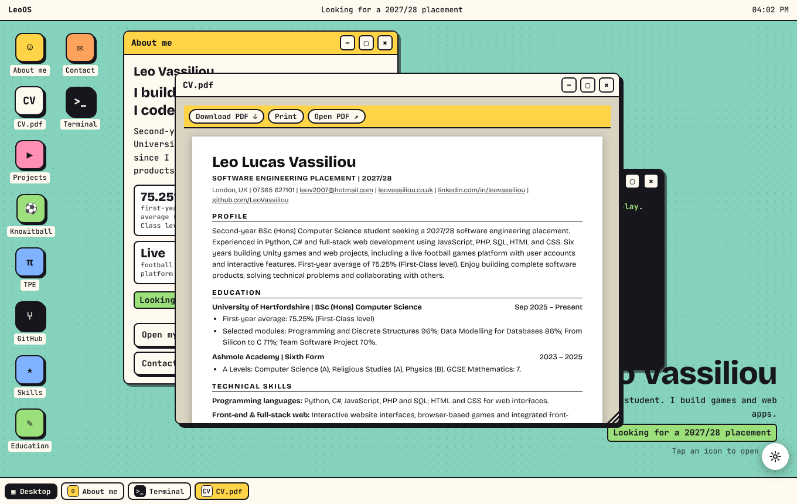

# Leo Vassiliou

**Second-year Computer Science student (University of Hertfordshire) seeking a 2027/28 software engineering placement.**

[**Live site**](https://leovassiliou.co.uk) · [CV (PDF)](Leo-Vassiliou-CV.pdf) · [LinkedIn](https://www.linkedin.com/in/leovassiliou) · [Knowitball](https://knowitball.co.uk) · leov2007@hotmail.com

**At a glance:** JavaScript, HTML/CSS, C#/Unity, Python, Git. Part of a team building Knowitball. Six years of making games. No frameworks needed for this repo: it is plain HTML, CSS and JavaScript with unit-tested logic.



## LeoOS: the portfolio is a little desktop

The default design is **LeoOS**, a desktop that runs entirely in the browser. Everything I'd normally link to opens in a window instead:

- **CV**: rendered in-page from the same data as the PDF, with download and print
- **Knowitball**: my football games platform, playable in a window (pick any of the six games)
- **TPE**: the [Theism Probability Engine](TPE/README.md), running live in its own window
- **GitHub**: a live list of my repositories from the GitHub API
- **Terminal**: a working command line (`help`, `cv`, `play`, `tpe`, `github`, `sudo hire leo`)
- Draggable, resizable, minimisable and maximisable windows with a taskbar; on phones each window goes full screen

The site has three more designs (Kickoff, Headline and Orbit), switchable from the button in the corner. Your choice is remembered.

## What's here

| Path | What it is |
| --- | --- |
| [`index.html`](index.html) | The whole site: one self-contained file of HTML, CSS and vanilla JavaScript. No build step, no framework. All content lives in one `D` object near the top. |
| [`TPE/`](TPE/) | **Theism Probability Engine**, an interactive probability tool. See [its README](TPE/README.md). |
| `Leo-Vassiliou-CV.pdf` | My current CV. |
| `CNAME` | Custom domain. |

## Featured projects

- **Knowitball** ([knowitball.co.uk](https://knowitball.co.uk)): a browser-based football games platform with accounts, player profiles and six games, in beta.
- **Theism Probability Engine** ([/TPE](https://leovassiliou.co.uk/TPE/)): rate the premises of classic arguments and see how they should move your confidence. A full model plus a streamlined, unit-tested one.
- **Unity / C# games**: six years of independent game development.

## Quality

- Unit tests for the probability maths: `node TPE/tests/engine.test.js` and `node TPE/tests/beta.test.js`
- Accessibility: labelled controls, keyboard focus styles, reduced-motion support
- No build step, no dependencies, works offline once loaded

## Run it locally

```bash
python3 -m http.server 8000
# then visit http://localhost:8000
```

(Serving it, rather than opening the file directly, lets the TPE window load.)

## Contact

[leov2007@hotmail.com](mailto:leov2007@hotmail.com) | [LinkedIn](https://www.linkedin.com/in/leovassiliou) | [GitHub](https://github.com/LeoVassiliou)
