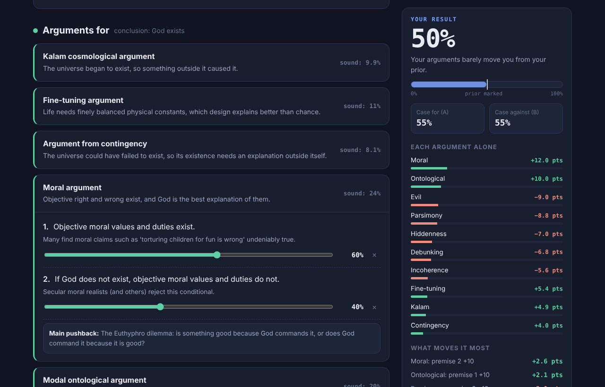

# Theism Probability Engine

An interactive tool for working out how much the classic arguments for and against God *should* move your confidence, using Bayesian conditioning with every step of the maths shown on screen.

**Live:** [leovassiliou.co.uk/TPE](https://leovassiliou.co.uk/TPE/)



## How it works

1. **Set a prior**: how likely is it that God exists before you weigh any argument?
2. **Rate premises**: ten arguments (five for, five against), each broken into two or three premises. Rate how likely each premise is to be true, 0 to 100.
3. **Soundness**: an argument only works if all its premises hold, so its chance of being sound is the product of its premise ratings.
4. **Combine**: let *A* be the chance that at least one argument for God is sound and *B* the same for the arguments against. A sound argument settles its conclusion; an unsound one tells you nothing, so you fall back on your prior. Both sides can't be sound at once, so the model conditions on that:

```
P(God) = [ A(1 - B) + prior * (1 - A)(1 - B) ] / (1 - A * B)
```

The result panel also shows what each argument would do on its own and which single premise your answer is most sensitive to (a +10 point nudge to each, ranked).

### Arguments covered

| For | Against |
| --- | --- |
| Kalam cosmological | Problem of evil |
| Fine-tuning | Divine hiddenness |
| Contingency | Parsimony (Occam's razor) |
| Moral | Debunking from cognitive science of religion |
| Modal ontological | Incoherence of the divine attributes |

## Features

- Single self-contained `index.html`: vanilla HTML, CSS and JavaScript, no dependencies, no build step
- Shareable links that encode your ratings in the URL
- Autosaves to your browser (nothing is sent anywhere)
- Example worldviews to explore quickly
- Light and dark themes, keyboard accessible, responsive down to phone width

## Tests

The maths lives in a clearly marked block inside `index.html`. The test file extracts that exact block, so the tests always run against the shipped code:

```bash
node tests/engine.test.js
```

It checks, among other things, that results are always valid probabilities, that a stronger argument for never lowers P(God), that the code matches the closed-form formula, and that a prior of 50% with equally strong sides stays at 50%.

## Honest limitations

- Arguments are modelled as *deductive* (sound means the conclusion follows). Fine-tuning and evil are really probabilistic, so treat the output as structured thinking, not measurement.
- Premises and arguments are assumed independent.
- "God" is defined loosely as a creator-level, personal being.
- Ten arguments are a sample of the debate, not all of it.

## History

This is a rewrite. The original versions (`v1` to `v6`, the `bayes` experiments and the long-form `arguments.js` data) are kept in [`old/`](old/). The original (v2) multiplied probabilities together and called it Bayesian; this version defines the model properly, simplifies the interface and tests the maths.
