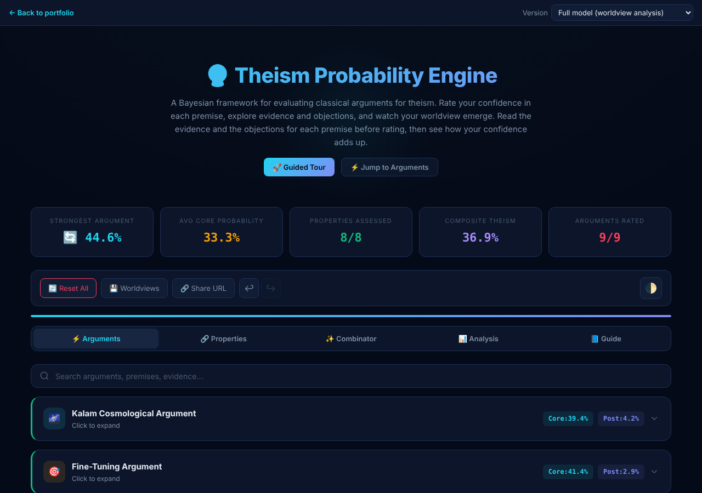
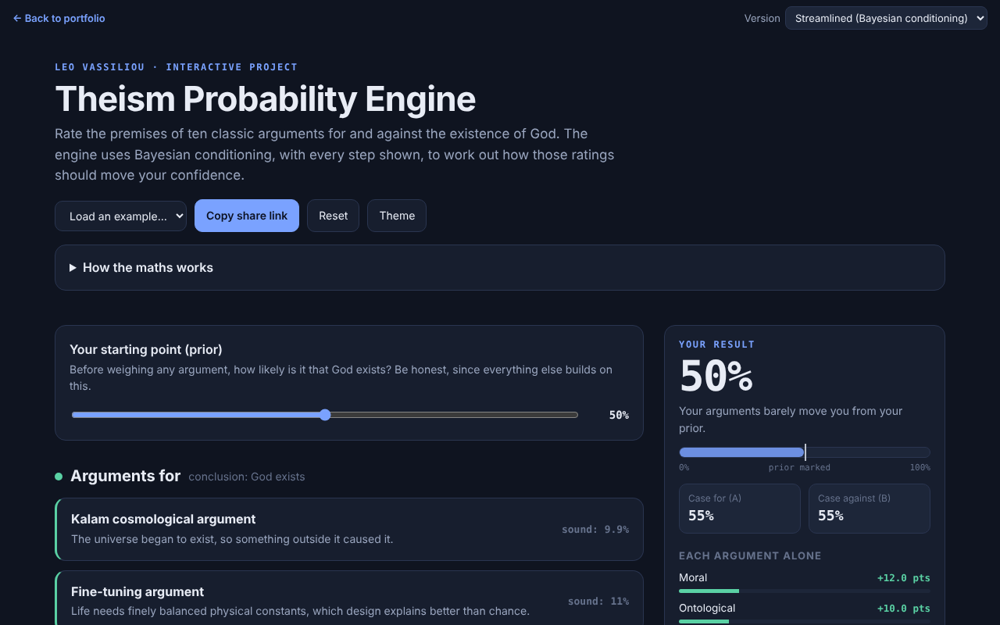

# Theism Probability Engine

An interactive tool for working out how much the classic arguments for (and against) God should move your confidence, with the maths shown on screen. It comes in two versions, switchable from the menu at the top of the page.

**Live:** [leovassiliou.co.uk/TPE](https://leovassiliou.co.uk/TPE/)

| Full model (`index.html`) | Streamlined (`streamlined.html`) |
| --- | --- |
|  |  |

## Full model: `index.html`

The original, rebuilt and polished. Nine arguments, each with premises, evidence, objections and rebuttals.

1. Rate each **core premise**. The core conclusion is the product of the premise probabilities.
2. Rate the **post-argument properties** (transcendent, personal, powerful, and so on), given the conclusion holds.
3. Several arguments supporting the same property combine with **noisy-OR**, so independent evidence adds up without double-counting.
4. **Entailment** flows automatically: "Christian God" entails every other property.

Also includes a worldview analysis, property radar, sensitivity analysis, a combinator, philosopher presets, undo/redo, saved worldviews, and shareable URLs.

## Streamlined: `streamlined.html`

A smaller model that also handles arguments *against*. You set a prior, rate premises, and the page conditions on the fact that arguments for and against cannot both be sound:

```
P(God) = [ A(1 - B) + prior * (1 - A)(1 - B) ] / (1 - A * B)
```

where *A* is the chance at least one argument for is sound and *B* the same for against. Ten arguments, five on each side. The maths is unit-tested:

```bash
node tests/engine.test.js
```

(The test extracts the engine block from `streamlined.html`, so it always checks the shipped code.)

## Features

- Self-contained pages: vanilla HTML, CSS and JavaScript, no dependencies, no build step
- Light and dark themes (follows your system), keyboard accessible, responsive down to phone width
- Ratings are saved in your browser and never sent anywhere

## Honest limitations

- Both models assume premises, and separate arguments, are independent. Treat the output as structured thinking, not measurement.
- The streamlined model treats each argument as deductive; real arguments such as fine-tuning and evil are probabilistic.
- "God" is defined loosely as a creator-level, personal being.

## History

Earlier versions (`v1` to `v6`, the Bayes experiments and the long-form argument data) are kept in [`old/`](old/) and reachable from the version menu.

## Evidence levels

A **Simple / Intermediate / Expert** switch in the toolbar changes every premise's evidence and objections (choice is remembered):

- **Simple**: one short plain-words line, about 35 words of evidence and one short objection.
- **Intermediate**: more detail, light referencing, 1-2 objections.
- **Expert**: dense, named scholars (Craig, Plantinga, Pruss, Oppy, Parfit, Ehrman and others), a "who defends / disputes" line, plus the original long notes in a collapsible section.

Content lives in `levels.js` (keyed by premise id). Objections get replies, not only rebuttals, and the Shroud premises are explicit about the 1988 dating.

## Stable and beta

There is always one **stable** version (`index.html`, confirmed good) and one **beta** (`beta.html`, work in progress). Both are in the version dropdown at the top. New features are built in the beta first; when one is solid it is promoted into stable.

Beta currently adds:
- **Arguments against** theism (problem of evil, divine hiddenness, naturalistic explanation, incoherent attributes, why people believe) and one extra argument for (consciousness), all with Simple/Intermediate/Expert levels.
- **Net result** tab combining both sides from your own starting point.
- **What would change your mind?** ranking the premises your result depends on most.
- **Compare with a thinker** showing where you differ most from a preset.
- **Dependency grouping** so related arguments (e.g. Resurrection, Liar/Lunatic/Lord, Shroud) are not counted twice.
- Per-premise **notes**, a downloadable **result card**, **print / PDF** report and a **guided tour**.
- Accessibility labels on sliders and tabs, and a skip link.

Tests: `node TPE/tests/engine.test.js` (streamlined) and `node TPE/tests/beta.test.js` (beta maths and data).

Also fixed in both: the Share URL now actually loads ratings when opened.
